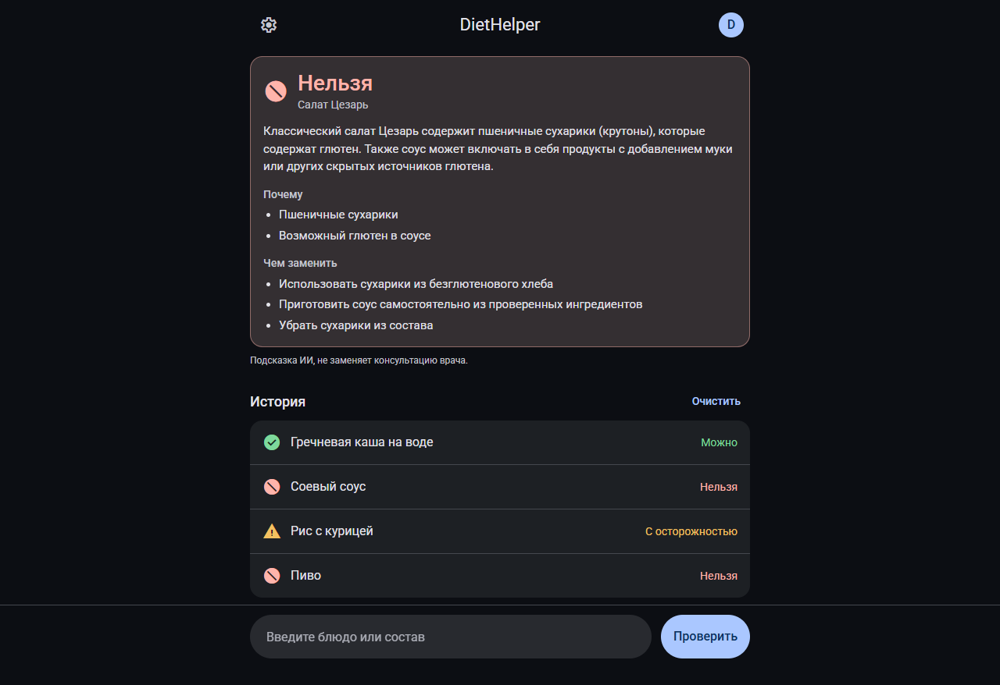
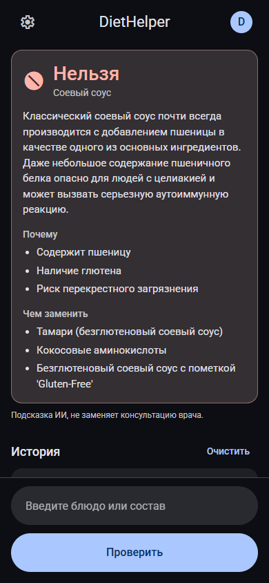
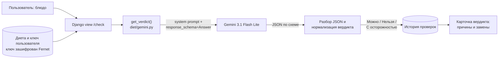

# DietHelper

**Русский** | [English](README.en.md)

Веб-приложение, которое по описанию вашей диеты и названию блюда отвечает: можно, нельзя или с осторожностью, и объясняет почему. Вердикт выносит Google Gemini со структурированным выводом по Pydantic-схеме; качество вердиктов измерено на 100 размеченных кейсах.

**Демо:** https://diet-helper-theta.vercel.app (нужны регистрация и свой бесплатный ключ Gemini)

[](https://github.com/kolganovr/DietHelper/actions/workflows/tests.yml)


<p align="center">
  
  
</p>

## Что умеет

- **Вердикт по блюду или составу:** "Можно", "Нельзя" или "С осторожностью" с коротким объяснением.
- **Разбор:** какие ингредиенты повлияли на решение и чем заменить блюдо, если оно не подходит.
- **Своя диета:** описывается свободным текстом ("целиакия", "кето до 30 г углеводов", "подагра").
- **История проверок** на главной.
- **Ключ Gemini пользователя** хранится зашифрованным (Fernet), в интерфейсе виден только хвост.
- **Онбординг** из трёх шагов и тёмная тема Material 3, работает на телефоне.

## Как работает



Ответ модели ограничен Pydantic-схемой:

```python
class Answer(BaseModel):
    verdict: Verdict          # enum: "Можно" | "Нельзя" | "С осторожностью"
    explanation: str
    reasons: list[str] = []
    alternatives: list[str] = []
```

Вердикт дополнительно нормализуется (`normalize_verdict`), ответ вне трёх значений не показывается пользователю, а превращается в понятную ошибку. Ошибки API (неверный ключ, лимит, сбой) тоже переводятся в понятные сообщения.

## Качество: eval

Набор из 100 кейсов "диета + блюдо -> ожидаемый вердикт" по 11 диетам (целиакия, лактоза, кето, веганство, диабет 2 типа, аллергия на орехи, low-FODMAP, подагра и др.), включая пограничные и неоднозначные блюда. Прогон через тот же код, что в проде.

| gemini-3.1-flash-lite (прод) | Весь набор (100) | Без спорных (87) |
|---|---|---|
| Accuracy | 77.0% | 83.9% |
| Macro-F1 | 0.76 | 0.82 |
| Опасные ошибки ("Нельзя" -> "Можно") | 0 из 38 | 0 из 35 |
| Ответ прошёл схему | 100% | 100% |
| Стабильность на 3 повторах (30 кейсов) | 93.3% | 92.9% |

Ошибки почти все на соседних классах: модель скорее перестрахуется, чем разрешит запрещённое. Сравнение с gemini-3.5-flash-lite и второй версией промпта, матрица ошибок, разбор ошибок и ограничения: [eval/REPORT.md](eval/REPORT.md).

## Стек

- **Backend:** Python, Django 4.2, Google GenAI SDK, Pydantic, cryptography (Fernet), WhiteNoise.
- **Frontend:** шаблоны Django, Material Web Components (сборка Rollup).
- **БД:** PostgreSQL в проде, SQLite локально.
- **Деплой:** Vercel, миграции применяются при сборке.
- **Качество:** Django-тесты, eval-набор, GitHub Actions.

## Запуск локально

Нужны Python 3.9+, Node.js и [ключ Gemini](https://aistudio.google.com/) (бесплатный).

```bash
git clone https://github.com/kolganovr/DietHelper.git
cd DietHelper
python -m venv venv
source venv/bin/activate            # Windows: .\venv\Scripts\Activate.ps1
pip install -r requirements.txt
npm ci && npm run build             # JS-бандл
```

Файл `.env` в корне:

```env
DEBUG=True
SECRET_KEY=any-local-secret
# python -c "from cryptography.fernet import Fernet; print(Fernet.generate_key().decode())"
FERNET_KEY=your-generated-fernet-key
```

```bash
python manage.py migrate
python manage.py runserver          # http://127.0.0.1:8000
```

Дальше: зарегистрироваться, в настройках (шестерёнка) добавить ключ Gemini и описать диету.

## Тесты и CI

```bash
python manage.py collectstatic --noinput
python manage.py test diet eval
```

`diet`: 27 тестов (шифрование ключа, вход и регистрация, проверка блюда, история, разбор ошибок Gemini; Gemini подменён). `eval`: 11 тестов метрик. GitHub Actions ([tests.yml](.github/workflows/tests.yml)) прогоняет их на каждый push и pull request на Python 3.9 (как в проде) и 3.12.

## Структура

```text
DietHelper/          настройки Django
diet/
  gemini.py          запрос к Gemini, схема Answer, нормализация вердикта, ошибки
  views.py           проверка, история, вход, настройки
  crypto.py          шифрование ключа пользователя (Fernet)
  tests.py
  templates/, static/
javascript/          исходники фронтенда (Rollup -> diet/static/diet/bundle.js)
eval/                набор кейсов, прогон, метрики, отчёт
.github/workflows/   CI
```
