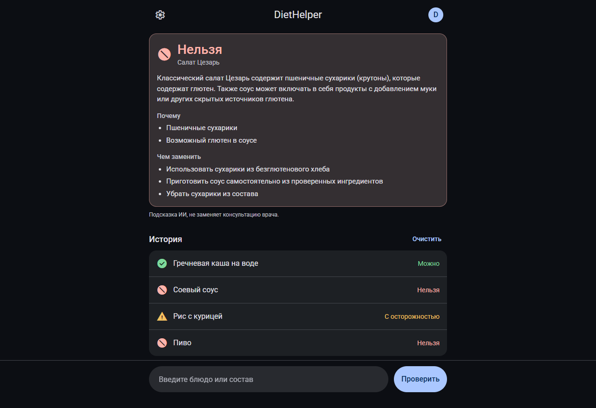
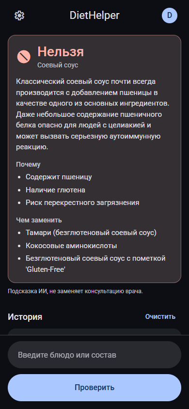
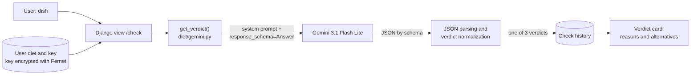

# DietHelper

[Русский](README.MD) | **English**

A web app that takes your diet and a dish and answers: allowed, not allowed, or with caution, and explains why. The verdict comes from Google Gemini with structured output constrained by a Pydantic schema; verdict quality is measured on 100 labeled cases.

**Demo:** https://diet-helper-theta.vercel.app (requires sign-up and your own free Gemini key; the interface is in Russian)

[](https://github.com/kolganovr/DietHelper/actions/workflows/tests.yml)


<p align="center">
  
  
</p>

## Features

- **Verdict for a dish or ingredient list:** "Можно" (allowed), "Нельзя" (not allowed) or "С осторожностью" (with caution), with a short explanation.
- **Breakdown:** which ingredients drove the decision and what to replace the dish with if it does not fit.
- **Your own diet** in free text ("celiac disease", "keto under 30 g carbs", "gout").
- **Check history** on the home page.
- **The user's Gemini key** is stored encrypted (Fernet); the UI shows only its last characters.
- **Three-step onboarding** and a Material 3 dark theme that works on phones.

## How it works



The model's answer is constrained by a Pydantic schema:

```python
class Answer(BaseModel):
    verdict: Verdict          # enum: "Можно" | "Нельзя" | "С осторожностью"
    explanation: str
    reasons: list[str] = []
    alternatives: list[str] = []
```

The verdict is also normalized (`normalize_verdict`): an answer outside the three values is never shown to the user and becomes a clear error message instead. API errors (invalid key, rate limit, outage) are mapped to clear messages too.

## Quality: eval

A set of 100 "diet + dish -> expected verdict" cases across 11 diets (celiac disease, lactose intolerance, keto, vegan, type 2 diabetes, nut allergy, low-FODMAP, gout and others), including borderline and ambiguous dishes. The eval runs the same code as production.

| gemini-3.1-flash-lite (production) | Full set (100) | Without disputed (87) |
|---|---|---|
| Accuracy | 77.0% | 83.9% |
| Macro-F1 | 0.76 | 0.82 |
| Dangerous errors ("not allowed" -> "allowed") | 0 of 38 | 0 of 35 |
| Answer matched the schema | 100% | 100% |
| Verdict stability over 3 repeats (30 cases) | 93.3% | 92.9% |

Almost all errors are between neighboring classes: the model tends to be overcautious rather than allow something forbidden. Comparison with gemini-3.5-flash-lite and a second prompt version, the confusion matrix, error analysis and limitations are in [eval/REPORT.md](eval/REPORT.md) (in Russian).

## Stack

- **Backend:** Python, Django 4.2, Google GenAI SDK, Pydantic, cryptography (Fernet), WhiteNoise.
- **Frontend:** Django templates, Material Web Components (bundled with Rollup).
- **Database:** PostgreSQL in production, SQLite locally.
- **Deploy:** Vercel, migrations run during the build.
- **Quality:** Django tests, eval set, GitHub Actions.

## Run locally

You need Python 3.9+, Node.js and a free [Gemini API key](https://aistudio.google.com/).

```bash
git clone https://github.com/kolganovr/DietHelper.git
cd DietHelper
python -m venv venv
source venv/bin/activate            # Windows: .\venv\Scripts\Activate.ps1
pip install -r requirements.txt
npm ci && npm run build             # JS bundle
```

Create `.env` in the project root:

```env
DEBUG=True
SECRET_KEY=any-local-secret
# python -c "from cryptography.fernet import Fernet; print(Fernet.generate_key().decode())"
FERNET_KEY=your-generated-fernet-key
```

```bash
python manage.py migrate
python manage.py runserver          # http://127.0.0.1:8000
```

Then sign up, open settings (the gear icon), add your Gemini key and describe your diet.

## Tests and CI

```bash
python manage.py collectstatic --noinput
python manage.py test diet eval
```

`diet`: 27 tests (key encryption, sign-in and sign-up, dish check, history, Gemini error mapping; Gemini is mocked). `eval`: 11 metric tests. GitHub Actions ([tests.yml](.github/workflows/tests.yml)) runs them on every push and pull request on Python 3.9 (same as production) and 3.12.

## Project layout

```text
DietHelper/          Django settings
diet/
  gemini.py          Gemini request, Answer schema, verdict normalization, errors
  views.py           check, history, auth, settings
  crypto.py          user key encryption (Fernet)
  tests.py
  templates/, static/
javascript/          frontend sources (Rollup -> diet/static/diet/bundle.js)
eval/                cases, runner, metrics, report
.github/workflows/   CI
```
